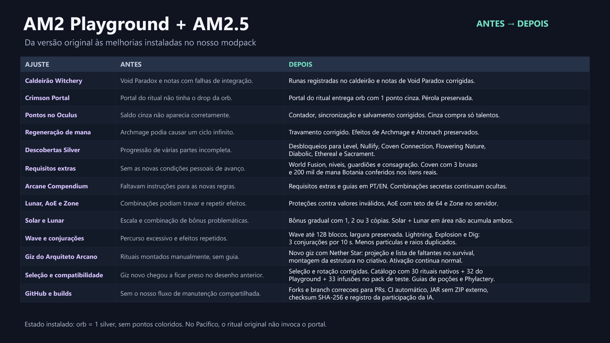

# Antes e depois da manutenção

Resumo das correções e melhorias até AM2.5 CR19 e Playground CR1.
O slide original abaixo retrata a etapa CR8; a tabela e o registro de validação
complementam as atualizações posteriores. Os históricos permanecem nas branches
`correcoes`, sem reescrita.

[Baixar o slide único editável](Resumo-antes-depois-AM2.pptx)

## Atualizações na ordem em que foram publicadas

Os primeiros commits de importação agrupam os reparos investigados anteriormente
na sessão. A tabela aponta os commits funcionais e de CI na ordem cronológica de
publicação. Ajustes menores de documentação continuam no histórico Git completo.

| Data (Manaus) | Atualização | Commit |
| --- | --- | --- |
| 31/10/2026 03:23 | AM2.5: proteções Lunar/AoE/Zone, escala Solar/Lunar, Wave até 128 blocos e limites de Lightning/Explosion/Dig | [cc5788f](https://github.com/Carairritante/ArsMagica2/commit/cc5788f) |
| 31/10/2026 03:23 | Playground: patches do caldeirão Witchery, notas de Void Paradox e recompensa do portal do ritual | [3825e93](https://github.com/Carairritante/am2playground/commit/3825e93) |
| 31/10/2026 03:28 | Playground: CI das ferramentas com JAR e SHA-256 separados, sem ZIP externo | [45e4fe9](https://github.com/Carairritante/am2playground/commit/45e4fe9) |
| 31/10/2026 03:34–03:36 | AM2.5: CI do mod e verificadores dos patches no JAR gerado | [be0a69e](https://github.com/Carairritante/ArsMagica2/commit/be0a69e), [d5f786e](https://github.com/Carairritante/ArsMagica2/commit/d5f786e) |
| 31/10/2026 04:11 | AM2.5 CR3: saldo Silver sincronizado e contador cinza no Oculus | [c34bcf3](https://github.com/Carairritante/ArsMagica2/commit/c34bcf3) |
| 31/10/2026 04:11 | Playground: ponto Silver livre na orb do portal do ritual | [6246608](https://github.com/Carairritante/am2playground/commit/6246608) |
| 31/10/2026 12:48 | AM2.5 CR4: pontos Silver livres compram somente talentos, na interface e no servidor | [45e4c17](https://github.com/Carairritante/ArsMagica2/commit/45e4c17) |
| 31/10/2026 12:48 | Playground: corrigido o ciclo infinito de regeneração de mana com Archmage | [3da1fa6](https://github.com/Carairritante/am2playground/commit/3da1fa6) |
| 31/10/2026 13:14 | Playground: recompensa final do portal passa a ser somente 1 Silver, sem pontos RGB nem habilidades | [7d03954](https://github.com/Carairritante/am2playground/commit/7d03954) |
| 31/10/2026 18:28 | AM2.5 CR5: evento de extensão do ritual World Fusion no servidor | [836a0d5](https://github.com/Carairritante/ArsMagica2/commit/836a0d5) |
| 31/10/2026 18:28 | Playground: sete descobertas avançadas, requisitos pessoais e Compendium sem revelar combinações | [f18f627](https://github.com/Carairritante/am2playground/commit/f18f627) |
| 31/10/2026 19:32 | AM2.5 CR6: novo Giz do Arquiteto Arcano, guia no survival e montagem no criativo | [85d46d5](https://github.com/Carairritante/ArsMagica2/commit/85d46d5) |
| 31/10/2026 23:41 | AM2.5 CR7: seleção e ações do giz corrigidas também no servidor integrado | [c947e79](https://github.com/Carairritante/ArsMagica2/commit/c947e79) |
| 01/11/2026 00:43 | AM2.5 CR8: compatibilidade opcional do giz com rituais e infusões do Playground, sem alterar seu JAR | [9b4f2df](https://github.com/Carairritante/ArsMagica2/commit/9b4f2df) |

## Estado atual e limites

As CR9–CR13 corrigiram Bless, traduziram o Compêndio, isolaram a iluminação das
prévias de criaturas, acrescentaram categorias opcionais e separaram as regras
do Playground do núcleo. Veja o [histórico completo](../CHANGELOG.md).

As etapas seguintes foram acrescentadas na ordem de desenvolvimento:

| Versão | Antes → depois | Commit |
| --- | --- | --- |
| CR14 | Busca só pelo nome exibido → inglês, tradução e termos parciais; 30 → 41 modelos nativos do giz | [aa0af08](https://github.com/Carairritante/ArsMagica2/commit/aa0af089ca1a20ba5fae8db041fade87065a942a) |
| CR15 | Lista simples → HUD azul com runas, progresso e seções | [f3d1a66](https://github.com/Carairritante/ArsMagica2/commit/f3d1a663545c0c99cce93957975b9495269849ae) |
| CR16 | Menu cinza → tema da HUD, seleção destacada e páginas adaptáveis | [eaec4a4](https://github.com/Carairritante/ArsMagica2/commit/eaec4a48bee98d7b4c53d22e8261586a373fd28c) |
| CR17 | Painel lateral → canto superior esquerdo, com fundo mais transparente | [67df9e0](https://github.com/Carairritante/ArsMagica2/commit/67df9e0378089b0c7245a83956ee1b6a0bbddedf) |
| CR18 | Posição e tamanho fixos → ajuste local por botão, incluindo transparência | [466ad91](https://github.com/Carairritante/ArsMagica2/commit/466ad915ae608b3be947a62c7af7debd8e7e01f6) |
| CR19 | Molduras compartilhadas entre cliente/servidor → filas por lado, consulta sem gerar chunks e limpeza ao sair do mundo | [d1a86ca](https://github.com/Carairritante/ArsMagica2/commit/d1a86ca0d68e6e7a3cf99197a5df64e2f4c5081d) |

[Versões, checksums e limites da validação da CR18](VALIDACAO-CR18.md).
[Diagnóstico, validação local e limites da CR19](CORRECAO-MOLDURAS-CR19.md).

No Playground CR1 (antes `independent-silver-oculus`), o painel nativo passou a mostrar os
quatro saldos em 2x2, ativado pelo anúncio do servidor. A mesa de inscrição não
mudou; essa alteração pertence ao addon, sem dependência de uma CR personalizada.

- A orb do Crimson Portal criado pelo ritual concede **1 Silver**, sem pontos
  coloridos ou habilidades. A pérola original continua no drop. Portais naturais
  não recebem essa recompensa extra.
- A proposta posterior de 5 pontos de cada cor + 1 Silver foi cancelada, não foi
  instalada e não faz parte dos patches publicados.
- O ritual original não invoca o portal no Pacífico. Não alteramos essa regra nem
  a dificuldade do jogo do usuário.
- Level, Nullify, Coven Connection, Flowering Nature, Diabolic, Ethereal e Sacrament
  recebem progressão por descobertas, iniciação World Fusion e requisitos pessoais.
  O Compendium informa requisitos extras e preserva o segredo das combinações.
- As consultas verificam coven próprio com 3 bruxas e pelo menos 200.000 de mana
  disponível nos itens Botania carregados, sem consumir bruxas ou mana Botania.
  Nullify exige o Ender Guardian pessoal. Sacrament inclui consagração pessoal.
- O giz reconhece 41 modelos nativos desde a CR14 e acrescenta os desenhos do
  Playground instalado. Quantidades adicionais dependem dos mods do pack.
  Sobrevivência recebe projeção e conferência de materiais, montagem é exclusiva
  do criativo e não ativa o ritual.
- A CR8 avisa sobre três ritos com suspeita de falha original de ativação. Não
  conserta esses ritos. Caldeirão e ritos Witchery não fazem parte do catálogo do giz.
- O fork público do AM2.5 contém o código do mod. O fork público do Playground
  contém recursos e ferramentas de manutenção, não o JAR completo modificado.
  Esse JAR continua no arquivo privado já existente. O Actions do Playground
  gera ferramentas, não uma versão jogável completa do addon.
- Créditos e licenças originais preservados. A participação substancial do
  OpenAI Codex está documentada nos arquivos de divulgação de autoria.

## Colaboração

Abra PRs para `correcoes` nos forks de
[AM2.5](https://github.com/Carairritante/ArsMagica2/tree/correcoes) e
[Playground](https://github.com/Carairritante/am2playground/tree/correcoes).
O CI continua automático por push e PR, com JAR e checksum separados, sem ZIP externo.

## Referências da manutenção

- [Changelog do AM2.5](https://github.com/Carairritante/ArsMagica2/blob/correcoes/CHANGELOG.md)
- [Compatibilidade do giz na CR8](https://github.com/Carairritante/ArsMagica2/blob/correcoes/docs/COMPATIBILIDADE-RITUAIS-CR8.md)
- [Patches do Playground](https://github.com/Carairritante/am2playground/tree/correcoes/maintenance/src)
- [Resultados dos testes do Playground](https://github.com/Carairritante/am2playground/blob/correcoes/maintenance/RESULTADOS.md)
